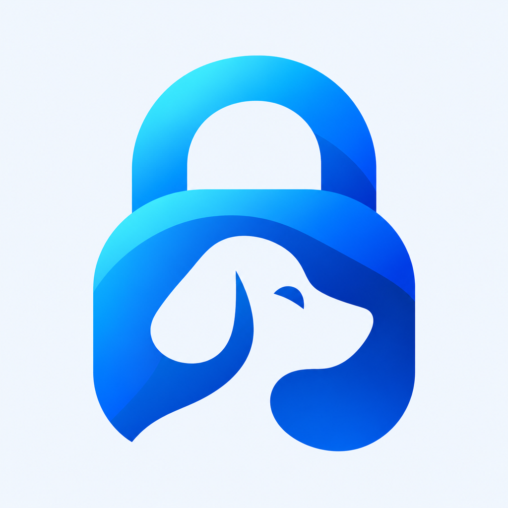

> **Submission hold:** October 23 security fixes and independent Guest Mode are required for 1.0. Build50 is historical, not the submission candidate. See [launch triage](docs/portable-vault/security-launch-triage.md).

<p align="center">
  
</p>

<h1 align="center">WagLock</h1>
<p align="center"><strong>We Always Guard.</strong></p>
<p align="center">An open-source, local-first photo, video and file vault for iPhone and iPad.</p>

WagLock combines encrypted media storage with nested albums, separate album passwords and optional Face ID. Core local use works offline without an account. Existing features are free, with no VIP walls, subscriptions or item-count caps beyond available storage.

WagLock is an independent fork of [SealedPocket / ZeroNet Space](https://github.com/materialofair/zeroNet_Space), not the official upstream app. Original attribution and license notices are preserved.

> **Development preview:** test with disposable media and keep independent originals. The fresh release candidate encrypts library metadata and supports explicit age backup recovery. Existing development libraries retain legacy limitations. Independent alternative vaults are unfinished. WagLock has not completed an independent security audit.

[Build it](#build-and-run) · [Security and recovery](#security-and-recovery) · [Roadmap](#roadmap) · [Development docs](docs/portable-vault/README.md)

## What works today

- **Local media library:** browse photos, videos, audio and files; import through Photos and Files; preview and share supported formats.
- **Nested albums:** create albums and subalbums under **Photos → Albums**. Choose inherited protection, a separate album password, password-or-Face-ID access, or Face ID-only access. Ancestor protection still applies.
- **Vault unlock:** use a vault password with optional Face ID convenience. Switch between Number pad and Full keyboard without changing the password text. Password quality feedback appears when setting or changing a password, not during login.
- **Session locking:** backgrounding locks albums and revokes managed export/document-preview access. The fresh release locks the vault immediately on background; legacy Dev retains its documented timeout/recording policy.
- **Free local features:** no purchase prompts or paid feature gates. Storage capacity is the practical limit on imports.
- **Adaptive interface:** redesigned libraries, players and settings; System, Light and Dark appearance.
- **English beta interface:** app-controlled UI and diagnostics are English. User filenames, passwords and other Unicode content are preserved.

The app also includes notes and audio import/playback. New audio recording is deferred from the hardened 1.0 release. In the fresh release configuration, note fields and drafts are encrypted with the library; a full Markdown editing/rendering feature remains planned.

## Current development status

As of **October 23, 2026**, build 50 prepared a separate **WagLock 1.0** fresh encrypted library under `com.d2sci.waglock`. Models, thumbnails, notes and drafts persist in an authenticated encrypted index with a memory-only UI projection. New credentials use an independent random data secret retained across password changes. Existing **WagLock Dev 1.3.8 (44)** and its library are preserved. This is not a migration. See [the fresh-library contract](docs/portable-vault/fresh-encrypted-library.md) for evidence and limits. Native video viewing uses standard AVKit controls. Build47 corrects Apple-directory alias validation; the owner confirms the new library opens and survives repeated locking. Build48 corrects the localized app label: release is WagLock, development is WagLock Dev. Build49 makes unfinished notes visible with Resume draft and flushes the latest pending edit before background locking. Build50 corrects delayed encrypted autosaves cancelling themselves, stabilizes editor navigation during draft-list refreshes, and preserves current text across reappearance; the owner has now passed the complete phone and independent backup-recovery checklist. The intermittent classification report remains tracked; Apple distribution signing and submission declarations remain pending.
Build51 hardening removes calculator authentication, persists password budgets, adds versioned stronger password wrappers, contains storage paths, owns temporary plaintext jobs and locks immediately with synchronous key revocation. Build51 verification:298 unit/security tests pass, and the owner passed the requested phone checks on October24. Independent Guest Mode remains open.

The immediate target is a first App Store submission with manual release, including the now-required independent Guest Mode. [Submission preparation and readiness gates](docs/release/submission-plan.md) track the licensing route, security/recovery work, final identity, privacy/support, listing and exact-archive validation. The proposed store identity is separate from the existing development app. **No App Store submission or public-release approval is announced.**

| Capability | Status |
| --- | --- |
| Encrypted media, nested album passwords and optional biometrics | Available in the development app; further hardening remains |
| Encrypted export with independent desktop extraction | Build 39 development candidate; password/recovery-key choices, nested protection and Files/cloud destinations; see limits below |
| Separate populated vault selected by an alternative passcode | Required for1.0, in development; inherited Guest Mode is presentation-only and disabled in the public candidate |
| Encrypted Trash with configurable retention | Planned; enabled with seven-day retention by default when implemented |
| Encrypted note fields/drafts | Fresh release candidate; full Markdown editing and encrypted search remain backlog |
| Consent-controlled shared albums | Discovery/prototype planning; not available in the app |

See [device-testing records](docs/portable-vault/device-testing.md), [build evidence](BUILD_ERRORS_SUMMARY.md) and the [prioritized backlog](docs/portable-vault/backlog-priorities.md) for scope and outstanding work. An internal TestFlight beta is planned; this README does not announce a public beta or App Store release.

## Security and recovery

WagLock currently uses its inherited custom encryption format, extended with authenticated ZNSC v2 stream framing for new streamed writes. Legacy readers remain supported. **It is not currently a Cryptomator-native vault.**

Important boundaries in the current build:

- Fresh release libraries encrypt metadata, thumbnails, notes/drafts and album names/hierarchy. Existing development libraries retain their legacy plaintext metadata; no automatic conversion is performed. Whole authentic database rollback remains an open limitation.
- Copying encrypted media alone is not a supported recovery procedure. Device-bound Keychain material can be required, especially after password changes. Do not rely on WagLock as the only copy of a library.
- Face ID-only albums have no album-password fallback. Losing their device-bound biometric factor can permanently prevent access. Password-or-Face-ID albums retain a password path.
- The public release candidate hides presentation-only Guest Mode. The development app retains it; neither provides the requested independent alternative vault or forensic deniability.
- Local cleanup cannot retract a copy already handed to another app. PDFKit, QuickLook, decoder caches and other preview paths remain part of the ongoing audit; no secure-deletion guarantee is made.

Read the [architecture/security audit](docs/portable-vault/audits/D2S-105.md), [album key boundaries](docs/portable-vault/albums-and-biometrics.md) and [recovery requirements](docs/portable-vault/requirements.md) before testing with meaningful data.

### Portable export research

The export experiment creates a Cryptomator-format candidate with encrypted manifests and a separately password-protected inner vault. Both macOS and iOS-simulator outputs have been opened by the official, unmodified Cryptomator CLI, with matching recovered file hashes. The outer password cannot unlock the inner vault.

Completeness requires additional verification: the standard reader can accept a valid prefix after a complete final chunk is removed. The experimental manifest verifier detects that loss. Successful desktop opening alone is not a completeness check.

Build 39 adds an additional **age-encrypted backup** under Settings → Encrypted backup. Choose a password or an existing age X25519 recovery recipient, retain separate protected album passwords, and save finished ciphertext through the native iOS Files picker to local storage, iCloud Drive or an installed provider. Optional Face ID-only album copies require explicit consent, real biometric authorization and a new separate export password. Export does not rewrite native storage or credentials.

The open-source recovery helper automatically downloads and verifies age if needed, then invokes the official tool and verifies content/hierarchy before publishing a new desktop extraction directory. Recovered photos/files use original names and extensions under **Library**, albums become nested folders, and notes/drafts are available as Markdown files. The app's ready screen lets you edit or clear the backup filename before saving. Synthetic iOS exports recover seven payloads plus notes/drafts and two nested password domains without the phone/Keychain; a 64 MiB + 3-byte stream also recovers byte-exactly. Build40 automated regression passes 207 unit/security tests plus 57 Python tool tests. **Older buffered native files above 64 MiB currently block complete export**; device settings/biometric registrations are excluded explicitly. This is not an in-app restore wizard. Fresh release metadata encryption is implemented; broad physical-device/provider validation and inherited distribution review remain open.

- [Create, save and independently recover a backup](docs/portable-vault/backup-recovery.md)
- [Age format, cryptographic options and dependency decisions](docs/portable-vault/age-backup-design.md)

- [Design, evidence and readiness gates](docs/portable-vault/portable-export-design.md)
- [Reproduce recovery of generated samples](spikes/cryptomator/RECOVERY.md)
- [Machine-readable experiment results](docs/portable-vault/portable-export-experiment-results.json)

## Build and run

### Requirements

- A Mac with Xcode and an installed iOS SDK/simulator runtime.
- **iOS 17.6 or later** for the app target, on iPhone or iPad.
- An Apple signing team for installation on a physical device.

Recent app validation used **Xcode 27.1**. The app uses Swift language mode 5; the optional isolated Cryptomator experiment requires Swift 6.2 or later.

### Fresh encrypted release configuration

The default scheme builds the separate legacy development app. For a **new** encrypted release library, explicitly use the release overlay:

```sh
xcodebuild build -project WagLock.xcodeproj -scheme WagLock \
  -configuration Release -xcconfig config/AppStore.xcconfig \
  -destination 'generic/platform=iOS' \
  -derivedDataPath /tmp/waglock-release CODE_SIGNING_ALLOWED=NO
```

This verifies compilation; device installation needs your own signing. Check the built Info.plist for `com.d2sci.waglock` and `WagLockEncryptedLibrary=YES`. A new identity has a separate library/Keychain. Never uninstall an existing app or copy live native storage as a migration shortcut. An explicit age backup is the supported independent desktop recovery path; automatic iOS backup and raw native-folder portability are not established.

### Open in Xcode

```sh
git clone https://github.com/donnellymjd/waglock.git
cd waglock
open WagLock.xcodeproj
```

1. Select the **WagLock** scheme and an available simulator or connected device.
2. For a new personal device installation, configure your own signing team and unique bundle identifiers for the app and test targets.
3. Build and run. Set a vault password and import disposable samples first.

**Updating an existing installation:** keep its bundle identity, Keychain namespaces and signing setup stable. The project's development app uses `com.d2sci.vaultito.dev`; the historical identifier is intentional. Changing it for branding creates a different credential/data identity. Do not uninstall or reset an existing vault to resolve a build issue.

See [phone setup and testing](docs/portable-vault/device-testing.md) for the installation boundaries and manual checks.

### Run tests

Find an installed simulator:

```sh
xcrun simctl list devices available
```

Replace `YOUR_SIMULATOR_ID` below with its identifier. Unit tests involving Keychain need simulator signing; the local ad-hoc settings are intentional.

```sh
xcodebuild test \
  -project WagLock.xcodeproj \
  -scheme WagLock \
  -destination 'platform=iOS Simulator,id=YOUR_SIMULATOR_ID' \
  -only-testing:WagLockTests \
  -parallel-testing-enabled NO \
  CODE_SIGN_IDENTITY=- CODE_SIGNING_ALLOWED=YES
```

Some UI tests require explicitly seeded, disposable QA simulators and skip elsewhere. Read their fixture guards before selecting them; do not run import workflows against a personal photo library.

The optional desktop-tool tests use Python's standard library:

```sh
python3 -m unittest discover -s tools -p 'test_*.py' -v
```

The [export experiment instructions](spikes/cryptomator/RECOVERY.md) separately cover its Swift build and independent CLI recovery. Those are research checks, not app installation or production backup instructions.

## Roadmap

The current order is:

1. Fix security and reliability findings; complete recovery/key-lifecycle foundations.
2. Deliver complete encrypted vault export with tested open-source decryption instructions, preserving nested-password boundaries.
3. Finish independent protection and recovery for nested albums, then independent top-level alternative vaults.
4. Add encrypted Trash with restore, configurable retention and a seven-day default.
5. Prepare the internal beta, corresponding source and distribution documentation.
6. Develop encrypted Markdown notes, encrypted local file search and optional consent-controlled shared albums.

Unlock-camera capture and an optional repeated-wrong-password self-destruct lock are also tracked. Destructive behavior needs a concrete reviewed design and explicit opt-in; it is not enabled today. These are development priorities, not committed release dates.

[Linear project](https://linear.app/d2sci/project/waglock-10d5618162e3) · [Detailed priorities](docs/portable-vault/backlog-priorities.md) · [Requirements](docs/portable-vault/requirements.md) · [Architectural decisions](docs/portable-vault/decisions.md)

## Contributing

Start with [AGENTS.md](AGENTS.md) and the [development documentation](docs/portable-vault/README.md). Keep existing readers, credentials and user data intact. Storage or recovery changes need disposable fixtures, failure-path tests and a source-preserving transition plan.

| Location | Purpose |
| --- | --- |
| `WagLock/` | SwiftUI app, models, services and view models |
| `WagLockTests/` | Unit/security tests and isolated storage experiments |
| `WagLockUITests/` | Simulator UI workflows |
| `docs/portable-vault/` | Requirements, decisions, audit findings and test evidence |
| `spikes/cryptomator/` | Isolated portability research; outside app dependencies |
| `tools/` | Migration-fidelity and export-recovery tooling |
| `design/` | Branding provenance and design work |

For bug reports, include the build number, device/iOS version and steps using disposable samples. Do not include passwords, recovery material or private media. Security-sensitive reports should omit exploit details from public issues until a private reporting route is agreed.

Older upstream guides, store copy and changelogs may describe historical behavior. Use the WagLock development docs and current implementation evidence as the source of truth.

## License and attribution

The repository preserves the upstream [GNU GPL version 3 license text](LICENSE), [copyright/modification notices](NOTICE.md) and [trademark guidance](TRADEMARK.md). WagLock is a modified fork of [SealedPocket / ZeroNet Space](https://github.com/materialofair/zeroNet_Space) and does not imply endorsement by its original authors.

Research dependencies have their own licenses. App Store/TestFlight distribution and dependency compliance remain review gates; an open-source repository is not, by itself, a declaration that every distribution route is cleared. The [historical upstream README](docs/portable-vault/provenance/README-before-waglock.md) is retained for provenance.
