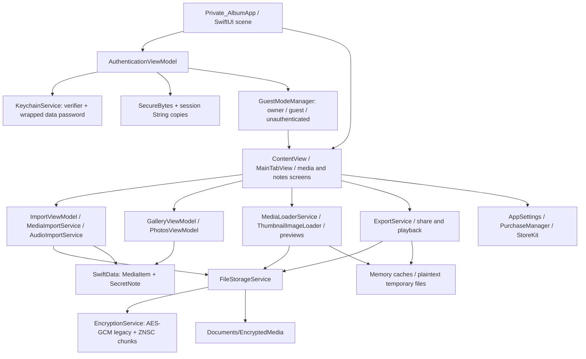

# D2S-105 — Initial architecture and security audit

**Status: begun; acceptance incomplete.** Reviewed 2026-10-17 (America/New_York). [Linear issue](https://linear.app/d2sci/issue/D2S-105/audit-sealedpocket-source-build-system-guest-mode-and-storage-paths). Scope: inspect source/build/storage/authentication/Guest Mode/dependencies, record architecture and prioritized reuse decisions. No runtime security fixes or storage replacement are included in this setup.

## Provenance and review limits

Baseline commit: `9adb6789810d00936a4ba7e4f38197626eb30a14` (`Clarify local privacy and open-source verification claims`), branch `main`; initial worktree clean. Local `origin` is `https://github.com/donnellymjd/zeroNet_Space.git`; `upstream` is `https://github.com/materialofair/zeroNet_Space.git`. Local `upstream/main` points to the same commit. No fresh fetch was performed, so this does not certify the latest remote revision. Existing checkout was reused rather than recloned. Upstream currently describes the app as SealedPocket, formerly ZeroNet Space.

Read root AGENTS.md, DEVELOPMENT_GUIDE.md, CONTRIBUTING.md, README material, LICENSE, TRADEMARK.md, existing build records, Xcode configuration and the implementation paths below. Some older docs claim iOS 15, encrypted thumbnails or broad security properties unsupported by current code. The root LICENSE contains GPLv3 text; branding restrictions are separately documented. Licensing and paid distribution conclusions remain D2S-106 work.

The repository includes app, services, models, unit/UI tests, resources and shared scheme. The app builds from the available source without an external binary SDK or fetched package. Target `packageProductDependencies` lists are empty and imports inspected are Apple frameworks/CommonCrypto/Combine. This is initial evidence of source availability, not a comparison with the distributed App Store binary or a complete dependency/SBOM attestation. StoreKit services still exist; source inspection is not proof of zero network traffic. Verify release artifacts and all configurations under D2S-120.

Findings distinguish direct code observations from inferred consequences. No adversarial device, backup extraction, cold recovery, Private Photo Vault export or desktop Cryptomator experiment has been performed. This is not an independent security audit.

## Current architecture



Current boundaries are SwiftUI/MVVM plus singleton services, not independent vault contexts. The shared SwiftData container is created at app startup, before successful vault authentication. Guest routing affects presentation; the same storage root/database remains present.

## Data and key inventory

| Surface | Current implementation and evidence | Implication |
| --- | --- | --- |
| Credentials | `Services/KeychainService.swift`: `savePassword`, `storeLoginPassword`, `hashPassword`, `storeDataPassword`; salted SHA-256 login verifier; wrapped data password encrypted through EncryptionService; entries use `kSecAttrAccessibleWhenUnlockedThisDeviceOnly`. | Device-only Keychain entries are not a portable recovery package. Fast verifier merits offline-guess analysis. |
| Data secret | `savePassword` initially sets `dataPassword = password`; `changePassword` rewraps the retained old data password. `retrieveDataPassword` falls back to login password only if wrapper is absent. | This is not a newly generated random master key. After password change, current login password alone does not decrypt files encrypted with the retained earlier data password. |
| Sessions | `ViewModels/AuthenticationViewModel.swift`: SecureBytes backing, `sessionLoginPassword: String`, computed `sessionPassword` String; logout wipes backing and clears two image caches. | Wiping one buffer does not establish zeroization of Swift String/Data copies or completion of background jobs. |
| Ciphertexts | `Services/FileStorageService.swift`: Documents/EncryptedMedia; UUID plus original filename when supplied, `.encrypted` suffix. Buffered writes atomic with complete file protection; streaming writes directly to final destination. | Ciphertext filenames expose original names. Interrupted writes need reconciliation. OS file protection is useful but does not replace vault encryption. |
| File formats | `Services/EncryptionService.swift`: buffered `salt(16) + IV(12) + tag(16) + ciphertext`; PBKDF2-HMAC-SHA256, 100,000 iterations, 32-byte key. ZNSC v1 streaming: magic/version/reserved/chunk indicator/salt, repeated length/IV/tag/ciphertext and zero-length terminator; default 4 MiB chunks. | Two custom formats, neither Cryptomator-compatible. KDF and format decisions require versioned legacy support. |
| Gallery database | `Models/MediaItem.swift`; `MediaImportService.processImage`, `processVideo`, `importSingleFile`; `ImportViewModel.performImport`. Original names/types/sizes/times/dimensions/durations plus raw JPEG thumbnail bytes persisted in SwiftData. `ThumbnailImageLoader` directly decodes bytes without a password. | Sensitive metadata and thumbnails lack application-level encryption despite comments claiming thumbnail encryption. Database/WAL/backup inspection required. |
| Notes/drafts | `Models/SecretNote.swift` stores title/content/tags directly; root app includes it in persistent schema. KeychainService also stores draft bytes in a device-only entry. | Notes have no vault-level encryption in this schema. Drafts need separate recovery and lifecycle analysis if retained. |
| Plaintext temps | `FileStorageService.createDecryptedTempFile` writes first, then sets complete protection, cleans failure; playback removes known temps. `ExportService` decrypts into `tmp/ZeroNetExport` using original filenames. Media import copies source videos into temporary storage; audio has its own temporary-recording cleanup. | Explicit plaintext working copies exist; cleanup/protection across locks, crashes and share destinations is not proven. Whole-vault encrypted backup is not implemented by plaintext export. |
| Defaults and purchases | `AppSettings`, `AppConstants.freeImportLimit = 75`, `ImportViewModel.checkImportLimit`, `Views/Settings/PurchaseManager.swift`. StoreKit initializes lazily; demo mode can unlock purchase features. | Unlimited-import fork goal is not implemented; audit must not infer it from bundle ID. Retire legacy caps under D2S-112/118. |

## Threat model for follow-up

Protect media bytes, thumbnails, names/EXIF/album membership, notes if retained, passwords/key wrappers and recovery materials. Relevant adversaries/events: someone using an unlocked phone without the vault password; someone with copied app files/backups or exported ciphertext; tampered/reordered/truncated encrypted files; guessed passwords; accidental loss, reinstall, crash, disk-full and migration failure. Main and decoy users must not cross security domains.

Trust boundaries: picker/source app → importer → encrypted filesystem and index; password UI → Keychain/KDF/session; authenticated session → background decoders/preview/share; local vault → backup/external computer; guest route → shared services. OS sandbox/Data Protection help but cannot justify claiming independent password protection of plaintext database contents. Rooted/compromised OS, live process compromise, external share recipients and flash-level secure deletion remain limitations to document, not guarantees to invent. Measure backup and app-switcher leakage on device.

## Prioritized findings

Severity is provisional product risk, not CVSS. High findings block the relevant Vaultito release promise until fixed and verified. No finding below is marked remediated by this documentation work.

| ID / priority | Observation, impact and evidence | Next validation / issue |
| --- | --- | --- |
| A01 — High | Plain JPEG thumbnails and metadata reach persistent SwiftData without encryption; notes store plaintext content. Source paths and methods in inventory above directly establish the write/decode path. Copying DB/WAL may expose sensitive content without a vault password. | Inspect disposable on-device database/WAL/backup while locked; choose protected index/notes migration and regression tests. D2S-116/112. |
| A02 — High | Keys/recovery depend on device-only Keychain wrappers, with initial data password equal to original login password. Rewrapping retains that secret across password changes. Copying ciphertext plus the current password is not a generally sufficient recovery scheme. `KeychainService.savePassword/changePassword/retrieveDataPassword`. | Fresh-device recovery before and after password change, including legacy files. Design portable recoverable key wrappers; never promise recovery of current libraries from new login password alone. D2S-110/111/114. |
| A03 — High | GuestModeManager returns content visibility from `currentMode == .owner`; guest login stores guest input as session secret, but no separate guest ciphertext/database root is created. `GuestModeManager`, `AuthenticationViewModel.login`, `Private_AlbumApp.sharedModelContainer`. | Test all guest read/write/export/navigation paths; design separate vault domains. Current behavior is an empty/hidden owner UI, not a populated independent decoy vault. D2S-115. |
| A04 — High | `EncryptionService.decryptFile` accepts fewer than four length bytes as successful EOF and zero length as completion. Chunks have individual GCM tags but no authenticated chunk index/order/final length; header fields are not bound as AEAD associated data. Static analysis predicts boundary truncation and within-file valid chunk reorder/duplication can escape detection. | Build adversarial fixtures: remove terminator/chunks, reorder/duplicate valid chunks, inject zero length, empty/header-only input, partial lengths and invalid version/salt/tag. Confirm failures and plaintext cleanup; version any fix and preserve readers. Not dynamically reproduced yet. D2S-116/107. |
| A05 — High | `KeychainService.changePassword` updates verifier before wrapped data secret, through multiple independent writes. Legacy service migration stops when the new `isSet` marker exists even if later account moves failed. `AuthenticationViewModel.detectAndClearOrphanedKeychain` clears credentials if a UserDefaults marker is absent. | Inject Keychain write failures/interruption, retry partial namespace migration, remove defaults with existing disposable vault and verify no recovery material loss. Avoid destructive reset heuristics. D2S-111/110. |
| A06 — High | Stream encryption writes final ciphertext before index commit; import rollback only rolls back SwiftData. Per-item import failures are logged and skipped, with no durable resume/integrity journal. `FileStorageService.saveEncryptedFile`, `ImportViewModel.performImport`, `MediaImportService.importMedia/importFiles`. | Kill/low-disk/save-failure/cancel fixtures; reconcile orphaned/partial ciphertext, atomic commit and verifiable resumable import. D2S-113/117. |
| A07 — High | Photos picker path converts UIImage to JPEG at quality 0.9 with generated IMG timestamp name (`MediaImportService.processImage`); this is not original-byte retention and does not establish source EXIF/Live Photo/album preservation. Files path is different. | Compare source and imported byte hashes/EXIF/capture dates/names, HEIC/RAW/Live Photo and videos across each export/import route. D2S-108/112/113. |
| A08 — Medium | Plaintext temp/export lifecycle and file protection are incomplete as an assurance: protection applied after preview write; export has no explicit protection/failed-output cleanup in `exportSingleItem`. Share-controller callback schedules cleanup on completion/error, but excludes clean cancellation (`completed == false`, no error). Duplicate original names target the same export path. | Trace share completion, cancellation, error, crash/relaunch, lock and duplicate names; inspect temp attributes/retention and external copies. D2S-114/116. |
| A09 — Medium | Salt/IV generators ignore `SecRandomCopyBytes` status; login verifier uses single salted SHA-256 while encryption uses PBKDF2. Nonce uniqueness depends on successful randomness; fast verifier may reduce password-guess cost if extracted. | Fail-closed RNG injection tests, KDF benchmarks/compatibility review, password policy and constant-time verifier review. Do not substitute a new incompatible KDF spec by assumption. D2S-111/116. |
| A10 — Medium | Original filenames in ciphertext paths and print logs, import paths/sizes/dimensions, export names and authentication mode logs expose metadata. `generateUniqueFileName` and MediaImportService/ExportService/GuestModeManager logging. | Inventory release logging and filenames; use opaque storage naming/redaction and inspect device/crash logs. D2S-116/121. |
| A11 — Medium | Cache clearing does not cancel queued thumbnail decode; `ThumbnailImageLoader.image` can repopulate cache after `clearAll`. Similar async read/session race coverage is unproven. Auto-lock skips while audio controller `hasRecording` and may be configured never. | Add session-generation/cancel tests and lock-during-decode/playback/recording tests; define product timeout policy. Preserve existing privacy overlay. D2S-111/116/117. |

## Reuse / harden / replace inventory

| Priority | Area | Recommendation |
| --- | --- | --- |
| P0 | Legacy encryption/storage/readers | Preserve for compatibility and fixture extraction now; harden corruption/transaction handling. Decide future replacement only after ADR-002 gates. |
| P0 | Keychain/auth/session/recovery | Reuse system Keychain integration patterns, redesign recoverable key lifecycle and failure-safe updates. Retain calculator regression coverage; don't assume memory wiping is complete. |
| P0 | SwiftData metadata/thumbnails/notes | Redesign protection and recovery; evaluate encrypted portable metadata plus rebuildable device index. Preserve originals and migrate disposable fixtures first. |
| P0 | Guest presentation routing | Reuse UI patterns only; replace security boundary with independently keyed vault contexts. |
| P1 | Photos/Files/audio import and export | Reuse picker/decoder bridges selectively; redesign original-preserving, resumable, verified imports and scoped plaintext lifecycle. |
| P1 | Gallery/views/loaders | Reuse SwiftUI presentation and bounded background image decoding; add album UX, paging/performance and lock-session isolation. |
| P1 | Purchase limits and branding | Retire arbitrary caps/VIP dependency for core local use; plan identifiers/attribution/pricing separately. Existing StoreKit code is not the release entitlement design. |
| P2 | Audio/notes/calculator/icon/localization | Retain as inherited code during audit; decide scope and avoid extra feature commitments. Reuse localization/resources/tests where appropriate. |
| P1 | Build/release docs | Correct obsolete deployment/security claims; publish tagged self-build and recovery evidence, license inventory and distribution decisions. |

## Baseline verification

Toolchain: `xcodebuild -version` → Xcode 27.1, build 27A9275. `xcodebuild -list -project ZeroNet-Space.xcodeproj` found app, unit/UI test targets and shared ZeroNet-Space scheme. App and unit-test target deployment settings are iOS 17.6, Swift language mode 5.0; project-level historical 15.0 does not establish runtime support. Existing identifiers/team were retained.

Commands executed:

```sh
xcodebuild -project ZeroNet-Space.xcodeproj -scheme ZeroNet-Space \
  -destination 'generic/platform=iOS' \
  -derivedDataPath /private/tmp/portable-vault-audit-derived \
  CODE_SIGNING_ALLOWED=NO build

xcodebuild test -project ZeroNet-Space.xcodeproj -scheme ZeroNet-Space \
  -destination 'platform=iOS Simulator,name=iPhone 15' -destination-timeout 5 \
  -derivedDataPath /private/tmp/portable-vault-audit-tests \
  -only-testing:ZeroNet-SpaceTests
```

- Device-target Debug compile: **BUILD SUCCEEDED**, exit 0, unsigned. This does not meet signed physical-device acceptance. Warnings include unassigned asset children and SwiftData isolation/Sendable issues that become errors under Swift 6 mode.
- Unit test invocation: **could not run**, exit 70, requested simulator unavailable. Xcode reports CoreSimulator 1171.7.0 older than required 1174.9.2; no usable matching simulator destination. No test results counted as passing. UI tests skipped for the same runtime limitation.
- Build/test logs: `/private/tmp/portable-vault-audit-build.log` and `/private/tmp/portable-vault-audit-tests.log` (local, ephemeral, not recovery artifacts or checked-in evidence).
- A connected physical device appeared in destination discovery. No signing changes or installation onto that device were attempted; current app uses inherited identifiers and could share a live data namespace. Use an isolated audit identity with disposable data for signed validation.
- Existing tests include calculator unlock, audio encryption round-trip/corruption/cancel/cleanup, asynchronous media reads, thumbnail decoding, icons and localization. They do not establish comprehensive encryption/Keychain coverage. Dedicated chunk ordering/truncation, recovery, decoy key isolation, interrupted commit and migration-fidelity tests remain absent from this review. Historical passed tests in BUILD_ERRORS_SUMMARY.md were not rerun successfully here.

## Acceptance and next work

- [x] Architecture diagram and storage/auth/import/purchase/dependency map recorded.
- [x] Prioritized reuse/rewrite inventory and provisional security findings recorded.
- [x] Existing checkout provenance and unsigned device-target build checked.
- [ ] Signed build/install/launch and media round-trip on an isolated physical-device vault; record OS/model/toolchain and results.
- [ ] Confirm release-source completeness, resources/configurations and license inventory against selected upstream/release tags.
- [ ] Dynamically reproduce A01–A11 using disposable fixtures; verify Guest Mode read/write restrictions and lock/recording behavior.
- [ ] Run unit/UI baseline after simulator toolchain repair or on an isolated signed device. Record exact failures and resulting follow-ups.
- [ ] Finish backup/iCloud/key recovery experiments and threat review with D2S-110/111/114/116; no recovery claims before evidence.
- [ ] Evaluate licensing/spike/desktop interoperability before any Cryptomator storage replacement (D2S-106/107/109).

Linear issue status was not modified by this local setup. D2S-105 must remain incomplete until the remaining acceptance evidence exists.

## Follow-up — build 23 stream integrity (2026-10-17)

The inventory and unchecked acceptance list above describe the initial audit baseline. Subsequent isolated signed device installation, simulator repair, album work and user-reported functional phone testing are recorded in [device testing](../device-testing.md) and the root BUILD_ERRORS_SUMMARY.md. They do not close all audit acceptance criteria.

For D2S-116, three adversarial tests reproduced A04: missing terminator accepted, records reordered successfully, and empty v1 streams accepted with the wrong password. Build 23 adds authenticated ZNSC v2 framing for new streamed writes, a tagged end marker and atomic protected output publication. Strict legacy framing rejects missing terminators/trailing bytes and excessive allocations; **v1 ordering/omission and empty-file authentication weaknesses remain intrinsic**. Existing files are not converted. The buffered format and normal v1 fixtures remain readable. There is no authenticated asset manifest or rollback detection.

EncryptionService now checks random-generation status; this partially addresses A09, without claiming every other RNG call is fixed. Failure/cancellation staging cleanup and late async-preview cleanup reduce part of A08; plaintext sharing, process-crash remnants and other cache lifetimes still need review. Main-library metadata/thumbnails, recovery and independent decoys remain open findings.

The full simulator unit suite passed: 65 tests (28 XCTest + 37 Swift Testing), including 14 stream tests. The generic development-signed iOS build passed. See [format details, reproducible checks and limitations](../stream-integrity.md). D2S-105 and D2S-116 remain incomplete; this is a targeted remediation, not an independent security audit or release approval.

## Follow-up — build 24 credentials, storage and caches (2026-10-17)

- A05: reproduced preferences-marker-triggered credential deletion and unverified legacy data-secret fallback. Startup no longer deletes credentials; setup cannot overwrite partial/unavailable records. Owner setup/password changes prepare and commit one authenticated namespace-bound record; failed changes retain the data key and previous usable record. Legacy login remains read-only. Failed legacy cleanup cannot reactivate old login credentials once a current record exists.
- A09: new owner credentials use the existing PBKDF2/GCM envelope for verification, without a separate fast hash. Old credentials keep the old hash until an explicit password change. KeychainService now checks salt RNG status. Guest/disguise formats and KDF benchmarking remain open.
- A08/A10: new ciphertext filenames no longer expose original names/extensions. Existing files/SwiftData metadata remain untouched. Storage preflight now propagates low-space/lookup failures and budgets stream overhead. Removed diagnostics from the encryption/storage/import services; other inherited logging and export lifetimes remain open.
- A11: generation-checked caches reject decodes completing after clear/background/logout, reject cancelled publication and separate preview password contexts. This does not establish pixel-memory zeroization or cleanup of every decoder/cache.

The build 24 unit phase passed 91 tests (28 XCTest + 63 Swift Testing), including 14 credential-recovery, six storage and six cache-security tests. The signed generic-device build passed. UI runner/device results and exact limitations are recorded separately in the root BUILD_ERRORS_SUMMARY.md. See [the implementation boundaries](../credential-and-cache-hardening.md).

An [isolated Cryptomator probe](../cryptomator-feasibility.md) and 79 upstream library tests also ran successfully. The probe reproduced undetected removal of a whole final chunk; it does not establish unmodified desktop compatibility or permit storage replacement. No production Cryptomator dependency or live migration was introduced. D2S-105/111/116 and the portability/recovery gates remain incomplete.

## Follow-up — build 25 import commit boundaries (2026-10-17)

Reproduced A06/A08 failures with paused imports: cancellation and logout did not prevent a later model save or success callback. Build 25 requires the originating owner session and operation generation at the commit boundary, shares one save path across import types, and cleans up only outputs verified absent from committed database state. Failed/uncertain commits, logout/relogin, stale completions, cancellation and partial batches have dedicated tests. Encrypted-password-sheet dismissal also revokes pending work. This is not a durable import journal; process termination can still leave orphaned ciphertext, and unknown startup files are never deleted.

Older-runtime testing exposed a calculator deinit back-deployment crash, addressed by a scoped workaround. See [implementation and verification](../import-lifecycle.md) and the root BUILD_ERRORS_SUMMARY.md for exact passing runs, earlier failed attempts and device installation status. The user-approved shared simulator restart restored build 24 UI testing; build 25 was additionally exercised on iOS 18.4.

D2S-108 now has [disposable export fixtures and a local comparison tool](../migration-fidelity.md), with seven tool tests passing. Actual source-app export fidelity remains blocked on access to the physical source app and a small dummy export. No migration recommendation, live conversion or recovery gate is accepted by this preparation.

## Follow-up — English beta and diagnostics review (2026-10-18)

The owner prioritized English-only UI/crash names, all features free, and audit work before a friend beta. Build 26 installed/launched on the paired iPhone, confirmed as version 1.3.8/build 26; see the build summary. Build 27 renames the executable/product while preserving bundle/Keychain/schema identity and removes all 151 inherited app Swift print diagnostics, including original filenames, media metadata, paths and authentication-state output. It also removes obsolete purchase/demo-flag code without bypassing authentication. This partially remediates A10; it does not encrypt existing metadata, redact OS crash dumps or prove safe plaintext export lifetimes.

Rechecked MediaItem and SecretNote persistence: A01 remains directly observable in the schema; the misleading thumbnail-encryption comment is corrected. A02/A03 recovery/independent-decoy findings remain open. The [beta-readiness assessment](../beta-readiness.md) distinguishes disposable functional testing from sensitive-library acceptance and records branding/source/distribution gates. Existing inherited icons were not replaced. Neither this work nor renaming constitutes independent audit completion or approval to distribute.

## Follow-up — isolated two-vault experiment (2026-10-19)

Owner-authorized D2S-115 prototype now exists only in the test bundle. Independent random secrets, encrypted fixture indexes and authenticated store/vault/purpose/asset envelopes passed cross-vault, substitution, lifecycle, failed/uncertain save, symlink, disk-full, marker-preservation, reopen and Unicode checks. Full unit run passed 120 tests; final strengthened target passed 17 isolation cases. See [the precise experiment boundary](../vault-isolation-prototype.md) and root build evidence.

A01/A03 are **not remediated for the installed app**: its shared SwiftData metadata and presentation-only Guest Mode remain unchanged. Prototype evidence supports designing explicit vault contexts; it does not approve a production metadata migration, storage replacement, biometric policy, Cryptomator adoption, recovery/deniability claim or release. D2S-105/115/116 remain incomplete.


## Follow-up — authenticated mount and legacy transition rehearsal (2026-10-21)

Build 29 moves the legacy persistent ModelContainer behind owner authentication. Presentation-only Guest Mode receives an empty in-memory schema; unauthenticated views no longer mount the shared owner index. Session/operation identities reject late opens and late authentication success/error after logout, background or a newer session. This partially addresses A03/A11 but does not scope all file/settings/cache services or implement a true alternative vault. Open errors offer Retry/Lock without resetting credentials or creating a fallback library.

Face ID enrollment now shows the owner's requested target-disclosure warning. After biometric consent, the real store checks session authorization/cancellation before Keychain mutation. Stale completion does not delete a global convenience account potentially owned by a newer enrollment. Two injected-authenticator tests preserve an existing disposable Keychain sentinel; these are not hardware Face ID validation. The owner selected optional Face ID assignable to either independent vault, replacing the proposed passcode-first default. Actual opaque target routing remains pending.

The test-only [metadata transition rehearsal](../authenticated-library-boundary.md) verifies current legacy metadata fields, retained synthetic key bytes, authenticated library/vault/record bindings, paged reads and failure-preserving staging. The successful read-only capture requires preparation of a disposable non-WAL clone; a direct read-only open of the self-contained WAL-header fixture failed without sidecars. This is a production snapshot design constraint, not permission to alter the live database or create plaintext migration clones. A01/A02, a durable mutable encrypted index, consistent WAL handling, independent contexts across all services, actual recovery and full hardware validation remain open. No live media/key/schema conversion or Cryptomator adoption occurred.

## Follow-up — build 32 export-session hardening

The [export service boundary](../export-session-boundary.md) addresses part of A08 and prepares one D2S-115 domain boundary: per-session authorization, immutable snapshots, operation-owned protected plaintext folders, scoped cancellation/cleanup, path checks and late-result suppression. The full unit suite passed 163 tests, including 12 export/security cases and actual owner/guest lifecycle checks. The final simulator share/cancel/background/reopen workflow passed; signed build 32 installed and device inventory confirms version 32. Physical export/receiver acceptance is pending. Audio/album/generic preview paths, plaintext metadata, portable recovery and independent-vault integration remain outstanding; A08 and the overall audit are not closed.

## Follow-up — build 33 common document previews

The [document preview boundary](../document-preview-boundary.md) partially addresses A08/A11: PDF/text/Markdown/JSON/CSV/log previews in the actual Files/gallery path now require the active owner capability, clear on background/session revocation and suppress stale success/errors. Six new lifecycle/security tests passed; complete units passed 169 tests and signed compilation passed. Generic QuickLook and other media/audio/album paths remain open; no metadata migration, independent alternative vault or audit completion is claimed.

## Follow-up — build 33 failed PDF acceptance; build 34 correction

Owner phone failure and two WagLock crash stacks exposed stale SwiftData record access while the PDF sheet dismissed after its library closed. Build 34 captures immutable preview/pager metadata, gates source actions by originating session and drives resume from capability revision. Hosted PDFKit and Files-pager lifecycle tests now cover this rendering boundary. Complete units passed 171 tests and signed compilation passed. A separate older-iOS scoped KeychainService teardown abort discovered by the new hosted test was corrected without credential mutation. See [failure analysis and precise validation](../document-preview-boundary.md). Build 33 is not accepted; build 34 owner check remains pending.

## Follow-up — build 35 photo viewer teardown

During Figma UI regression, a simulator share/background/resume flow terminated in `MediaItem.fileName.getter` from `PhotoDetailView.bottomBar(for:)` after its library closed. This is a confirmed photo-path instance of the stale-record rendering boundary, not a completed media lifecycle audit. Build 35 creates immutable photo entries and the complete pager at selection time, uses immutable image-read metadata, gates source actions by the originating session and rejects stale image publication. A real hosted photo-pager regression releases its disposable SwiftData store after logout and forces another render. Complete units pass 172 tests (61 XCTest + 111 Swift Testing). See [implementation and validation](../figma-ui-implementation.md) for repeat UI and phone evidence. A08/A11 and D2S-105 remain open. The owner already accepted the build 34 PDF phone retest; that does not establish build 35 photo acceptance.

## Build 38 note writes

A canceled delayed note save could still run, resurrect a cleared draft or touch an old owner context. [The note-write boundary](../note-write-boundary.md) adds generation/session/revision checks, write-time authorization and visible explicit-save failure. Eight deterministic security tests cover canceled/out-of-order completions and real authentication/Keychain transitions. This is a bounded D2S-116 correction; plaintext SwiftData notes (A01/D2S-143), broader lifecycle coverage and the full audit remain open.

## Portable recovery verifier follow-up — 2026-10-22

D2S-114/110/116: reproduced and corrected a destination-overwrite race in the isolated recovery harness. Added strict manifest hierarchy/alias/resource checks, WebDAV path/status checks and end-of-read inventory revalidation. The expanded 31-test tool suite passes; public macOS/iOS-simulator outputs are independently recoverable using the official CLI after hardening. See [scope and evidence](../portable-export-design.md#recovery-verifier-hardening--2026-10-22). This changes no installed app reader, format, dependency, metadata or credentials and does not close A01/A02 or the portability/licensing gates.

## Complete-library snapshot boundary — 2026-10-22

D2S-114/110/116/141: [read-only capture groundwork](../portable-export-snapshot.md) binds complete current-model metadata capture to the legacy owner mount/session/revision, rejects unknown persisted/catalog fields, preserves both draft stores and partitions independently password-protected albums. It blocks locked or Face ID-only albums rather than silently omitting/downgrading content. This writes no archive and does not change persisted plaintext metadata or recovery keys; A01/A02 and the broader audit remain open.

## Build 39 — Additional encrypted backup and independent extraction

D2S-114/110/116/141: [age backup](../age-backup-design.md) adds password/scrypt and X25519 recipient wrapping, independent nested child encryption, encrypted metadata/manifests, explicit Face ID-only export consent/new passwords, native Files/cloud copying of completed ciphertext and a strict independent recovery helper. Official age 1.3.2 recovers seven payloads plus metadata/notes/drafts/two nested domains from synthetic iOS-written output; parent credentials fail for child domains. Empty/exact-chunk, tampering and final-chunk truncation checks pass; a 64 MiB + 3-byte native stream recovers byte-exactly. Full unit/security regression: 206 tests; Python tools: 41. Source keys/readers/native records are unchanged. New dependency source is a pinned BSD-2-Clause scrypt core with full source/bundled notices; no Cryptomator app dependency.

This supplies an independent extraction path for supported completed backups, not native library recovery from raw ciphertext or a restore wizard. Large legacy buffered sources above 64 MiB block complete export; native metadata A01, original device-key recovery A02, independent alternative vault A03, broad platform/scale validation and inherited GPL/distribution acceptance remain open. Device/provider acceptance is recorded separately; no real owner media was inspected by development tools.


### Mutable metadata candidate — 2026-10-22

[Unused encrypted index](../encrypted-metadata-candidate.md) adds authenticated record updates, revocable capabilities, paged reads, inventory verification and transaction failure tests. Synthetic legacy payloads round-trip without modifying the source. It has no production mount caller; A01/A03 remain open on the installed build 40. Consistent live WAL capture, every-writer adapters, staged/resumable activation, cold recovery, source-retirement review, antirollback design and device/scale validation remain required.


### Typed model and resumable staging evidence — 2026-10-22

The unused metadata candidate now has a versioned all-field adapter for MediaItem/SecretNote/VaultAlbum and a memory-only read projection. Model-only stage progress is encrypted and committed with each batch; resume verifies the same source fingerprint and every saved payload before proceeding. Full regression: 230 tests passed; final targeted staging suite: 10 passed, including an additional committed-WAL fixture whose source DB/WAL bytes remain unchanged. Signed iOS compilation and the underlying index process-crash probe passed. [Exact scope and remaining activation gates](../encrypted-metadata-candidate.md#typed-model-adapter-and-resumable-staging). No live mount, original rewrite, key/identifier change or cleanup. Draft/settings/every-writer integration, coordinated WAL capture, activation/rollback, full cold recovery and source-retirement review remain required. A01/A03 and the overall audit remain open on phone build 40.
