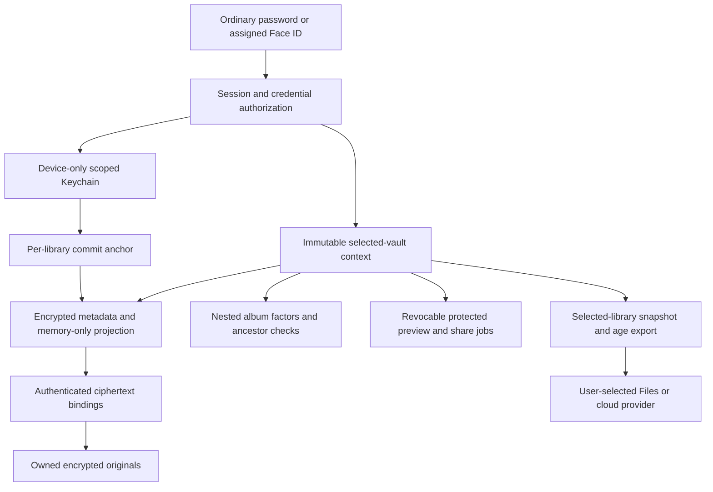

# First-release security closeout — October26,2026

Scope: accepted WagLock1.0(63), current source review, candidate64's dated-backup-name presentation change and release-config parity. This is a maintainer engineering review, not independent audit certification or a claim that no vulnerability exists. The original D2S-105 diagram/findings and build50/53 reports remain historical evidence. There are no external users; compatibility/migration for older test versions is not a first-release requirement. Tested readers need not be removed merely to create a break, and no automatic reset is authorized.

## Current release architecture

Primary/alternative credentials wrap independent random data secrets. Only the chosen library is mounted; imports, album service, previews, notes/drafts, backup/reminder state and exports use scoped contexts/capabilities. Lock/background/capture revokes selected capabilities and late work cannot publish into a different session. Main-only password management requires fresh credentials and rejects collisions; ordinary collision login still selects the alternative library. No vault backend, account, ads, telemetry, paywall or hosted shared-album service exists in the inspected app.

## Finding dispositions

| Issue | Verified implementation and acceptance | Residual boundary |
| --- | --- | --- |
| D2S-162, ciphertext substitution / legacy streams | `LibraryMountCoordinator` binds release storage to the authenticated encrypted repository. Registry/inventory digests verify the exact buffered/streamed bytes consumed before publication, including previews, sharing and backup. Tests reject same-key file swaps after reopen and preserve sources/destinations. Public release rejects native v1/.encrypted imports. Full354 baseline and actual-release workflows pass. | One-time enrollment cannot detect tampering that preceded a trusted baseline; no claim of legacy Dev protection or automatic native migration. |
| D2S-173, whole-copy rollback | Repository creation/open enables device-only per-library Keychain commit anchors. Authenticated recovery deltas reconcile exact pending pre/post-SQLite commit states; whole-copy and same-revision alternate branches, damaged/missing journals and unavailable anchors fail closed. Six adversarial tests pass in the full suite. | Protection assumes the trusted Keychain anchor is intact. An attacker restoring/deleting that trust state is outside this guarantee. |
| D2S-170, old password wrapping | New credentials use the modern versioned600000-round envelope. Authenticated primary/album upgrades preserve data secrets/policy with checked writes; wrong passwords/failures retain source records. Secondary legacy envelopes are rejected. | No external users require a historical migration path. This already-tested upgrade behavior is sufficient; no additional compatibility project is a launch gate. |
| D2S-169, timing | Absent optional secondary records perform comparable modern derivation; eight observations/path recorded absent/wrong/valid medians93.09/93.68/92.34ms in57. Regression tests retain equal derivation work. | I/O, authentication/mount paths and runtime behavior are not proven constant-time. No forensic-deniability claim. |
| D2S-167, Face ID ownership | Selected-vault controls/service guards prevent secondary takeover/removal of primary enrollment. Only a validated protected grant repairs its own missing/stale owner marker; cancellation does not. Both assignment/preservation cases pass; owner63 verified its own Disable control after biometric entry and normal Face ID. | Biometrics are password-backed convenience; device-bound album factors have explicit loss warnings. |
| D2S-172, guest disclosure | Secondary settings omit alternative management and unavailable Face ID controls/status. Eligible Face ID consent is neutral, as are backup/help/errors; source reviewed. Owner63 passed absence of guest management controls. Current actual Release64 decoy negative-path UI passes; see decoy-release-ui.json. | Public App Store disclosure/provider-owned password entries and external source/support pages cannot promise deniability. |
| D2S-178, collision access loss | Only primary sessions change login passwords. Current main and alternative passwords are freshly budgeted for alternative changes; both collision directions reject. Secondary API denial performs no primary reads. Source/readback checks preserve keys. Actual63 UI and owner phone checklist pass. | Existing colliding credentials are not silently rewritten. The owner's collision was recovered before upgrade. |
| D2S-175, password manager | Live exact dedicated webcredentials association and signed profile/app verified. Owner63 verified1Password fill/explicit confirmation/relaunch.64 selects the same accepted entitlement in the standard release config. | Owner-authorized provisioning refresh and local64 distribution export now pass with the exact association preserved. App Store server/account checks remain. Providers control their saved-entry UI. |
| D2S-176, deliberate erase | Checked explicit intent, exact root/service grammar, no-intent preservation, interrupted-stage recovery and scoped real-Keychain deletion are tested. Dedicated actual-release erase/cancel/fresh-setup UI passes on disposable64 fixtures. | No owner's phone erase or forensic physical-erasure guarantee. External copies/password-manager entries are preserved. |
| D2S-177, backup/reminders | Selected current password requires re-entry, online attempt budget and risk consent. Separate album factors remain. Owner63 verified cloud save/Mac recovery/reminder settings. Official age recovery and helper tests were rerun with public fixtures.64 dated/custom-name actual-release UI passes. | Files acceptance is not cloud completion; in-app restore is not implemented. Old exports retain their creation-time passwords. |

## Evidence and release limits

Baseline [build63](../../release/evidence/build-63/README.md):354 passing unit/security tests, actual-release password-management UI, signed source/package receipts and owner phone/provider acceptance. [Pre-launch evidence](../../release/evidence/prelaunch-2026-10-26/): independent official-age cold recovery verifies all seven real-format payloads, metadata/notes/drafts/Unicode and nested factors without the phone/Keychain;16 helper/layout plus11 bootstrap tests pass. Candidate64 has355 passing unit/security tests and actual-release backup/reset/decoy UI, with zero failures/skips; its own receipts remain separate from63. D2S-105/116/162/167/169/170/172/173/175/176/177 are closed with scoped evidence in Linear; D2S-178 was already Done. Distribution/account gates remain open.

Known limits remain explicit: screenshots/external cameras, complete Swift/OS/decoder memory zeroization, secure physical erasure, pre-enrollment tampering, restored/deleted trusted Keychain state, direct AirPlay hardware coverage, cloud-provider completion and provider-owned AutoFill disclosure. These are scoped threat-model limits, not newly claimed fixes. Cryptomator-native storage, shared albums, Trash, self-destruct, search and migration are deferred; do not advertise them as shipped.

D2S-105's architecture/device/reuse inventory is satisfied by the current architecture docs, signed phone candidate and the recorded staged findings; D2S-116's launch review has documented severity, mitigations, regression evidence and residual limits. Independent specialist review may continue separately without claiming this work provides one. Source/platform distribution, export/territory and account/provisioning checks remain external release gates, not security test passes.
