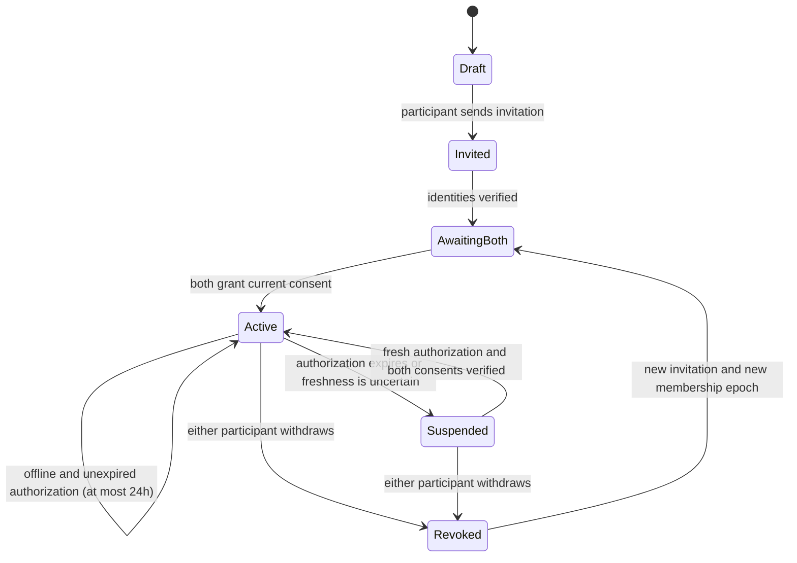

# Shared albums: requirements and feasibility brief

[D2S-139](https://linear.app/d2sci/issue/D2S-139), owner discussion **Open Source Photo Vault Apps**. Status: discovery in progress. No sharing protocol, dependency, cloud account, network permission, infrastructure purchase or initial-beta commitment is approved by this brief. Local vault use stays offline and account-free; sharing is optional and independent of unrelated private/alternative vaults.

## Owner requests

Two people share an encrypted album, each with independent key material and ongoing consent to the other's access. Keep media locally where practical, coordinate consent/key availability through cloud services, and transfer additions directly when feasible to reduce hosting costs. Investigate export restrictions and capture deterrence. Shared content must have its own encrypted metadata/media namespace, separate from both private vaults.

## Security boundary and feasibility

End-to-end encryption requires that delivery/coordination infrastructure cannot recover media keys. Do not store plaintext decryption keys on the server under an E2E claim. Recipient-encrypted key envelopes and device authentication are candidates; an envelope primitive alone does not implement pairing, consent, membership, revocation, recovery or a secure application protocol. [HPKE, RFC 9180](https://www.rfc-editor.org/rfc/rfc9180.html) is relevant to recipient encryption, subject to implementation review.

Once a participant has received a key or plaintext, a malicious/modified client can keep it. Deleting a server-side envelope, expiring a consent token or hiding an Export button cannot retract that knowledge. Proposed guarantees must distinguish honest-client access controls, denial of **new, not previously released** keys, and protection of future membership/key epochs. [MLS, RFC 9420](https://www.rfc-editor.org/rfc/rfc9420.html) offers a reference for authenticated group membership and key evolution, not a turnkey continuous-consent album or retroactive erasure mechanism.

| Candidate | What it can support | Important tradeoff |
| --- | --- | --- |
| Recipient key envelopes with offline access | E2E transfer and offline viewing after key receipt | No immediate withdrawal of previously delivered keys; future key epochs can exclude a removed participant |
| Online consent checks with short-lived client authorization | Prompt lockout in an honest app when either consent is withdrawn; explicit availability/expiry policy | Service/network outage can block viewing; a malicious recipient can retain keys/plaintext; a signature alone does not prevent cached access |
| Both devices cooperate in each key release | Requires fresh peer participation before releasing a new key | Peer must be reachable; retained reconstructed keys/plaintext still cannot be recalled; threshold/key-release design needs specialist review |
| Server stores usable media keys and controls release | Central authorization is straightforward | Server can decrypt; this fails the proposed E2E boundary |

Provisional direction: investigate E2E per-asset keys plus authenticated membership/key epochs and an explicit honest-client consent policy. Do not invent a crypto protocol or select a library from this comparison. Evaluate mature audited implementations, maintenance, platform support and licenses before adoption. Any promise of instant revocation while offline, against a malicious recipient, remains rejected as stated.

## Accepted offline policy and proposed consent state model

**Owner decision (2026-10-22): allow up to 24 hours of offline viewing after a successful online authorization that verifies both participants’ current consent.** The app may choose a shorter authorization, but must never extend it offline. On learning of withdrawal while connected, stop access immediately in the honest app; being offline delays learning withdrawal until reconnection or authorization expiry. Expiry requires a fresh online check of both consents before reopening.

The state model below is an honest-client UX proposal to validate, not a cryptographic guarantee. Server-signed tokens alone are insufficient: device identities, freshness, membership/album binding, replay resistance and local key handling need a complete design.

The 24-hour limit is an application access policy, not guaranteed erasure of previously delivered keys. Device wall-clock time alone is insufficient for a rollback-resistant expiry claim. The experiment must model monotonic elapsed time within a boot and fail closed or require online verification when time/freshness cannot be established after restart, clock rollback or restoration. Trusted time, service freshness, signed grant format and durable replay state remain design work.

A stale invitation/token cannot reactivate a revoked membership. Rejoining requires explicit new consent. Revocation closes the shared-album UI, revokes pending previews/transfers and purges revocable local caches in the honest app. It does not silently delete personal originals, undo external copies or imply forensic erasure. Whether each person retains their own contributions is an unresolved product decision; no destructive default is authorized.

## Pairing, transport and cloud exposure

- Pair two independently authenticated device identities; verify a QR/fingerprint or equivalent authenticated out-of-band check. Inviting a display name alone must not authorize access. Define additional devices, replacement/recovery, compromised-device removal and rollback behavior before implementation.
- Nearby transfer can use an encrypted transport carrying independently encrypted album data. Apple's [Multipeer Connectivity documentation](https://developer.apple.com/documentation/multipeerconnectivity) describes nearby connectivity and disconnection of sessions when backgrounded. It is not, by itself, a remote asynchronous internet delivery system.
- Remote direct delivery needs connectivity/signaling and may need a relay. An offline recipient needs a queue, a later simultaneous connection or encrypted store-and-forward. Compare those explicitly rather than assuming direct transfer eliminates server work. iOS background behavior must be measured on two real devices.
- The coordination service can learn device/pair relationships, access/consent timing, message sizes and traffic patterns even without plaintext keys/media. Minimize retention, avoid address-book uploads and document identity/account requirements only for sharing.
- Transfers need authenticated asset/album/epoch binding, chunk integrity, replay/duplicate protection, resumable encrypted staging, bounded storage and verified publication. Neither a received path nor a restored backup may target another local vault's storage or metadata index.

## Export/capture policy

The shared album may omit in-app export/share/save controls and limit plaintext preview lifetimes. Investigate platform-supported capture detection/protection and watermarking as deterrents, including accessibility and compatibility costs. These do not establish DRM against modified clients, external cameras or previously received media. Do not advertise “cannot be copied,” “disappears everywhere” or coercion safety.

The build 32 export session boundary is a useful local lifecycle pattern, not an implementation of shared-album consent. A shared album must have an explicit export policy and its own context; it cannot inherit the private owner's global exporter.

## Cost model to measure

Illustrative assumptions, not provider pricing or measured demand: 100 pairs, 100 new 5 MB assets per pair per month, one delivery per asset → **50 GB/month** of media transfer before overhead/retries. A relay fraction `r` implies roughly `50 × r` GB of relay delivery, plus uploads and other billable operations according to the chosen provider. Both people opening ten times/day implies **60,000 consent checks/month** over 30 days. Assumed 1 KB envelope/index metadata per asset adds about **10 MB/month**, before signatures, device records, logs, retention, backups and redundancy. Real protocol sizes and usage may differ materially.

Benchmark pairing, consent checks, push/signaling, relay fraction, encrypted queue duration, recovery and operational effort. Obtain current provider quotes only after selecting candidates; no cost-free or low-cost guarantee is established here.

## Decisions and next implementation gate

The 24-hour maximum offline policy is selected. Before production work, resolve: robust expiry across restart, device clock changes and restored backups; withdrawal semantics for historical media and personal contributions; additional devices/recovery; pairing identity UX; relay/queue retention; and honest export/capture messaging. Present the tradeoffs with a reviewable prototype before requesting a product decision.

Next proposed work is a **test-only two-client consent-state experiment**, with no real media or network infrastructure. Prove independent local contexts; signed identity/album/epoch/nonce binding; mutual grant/withdraw/regrant behavior; stale/replayed/expired tokens; exact 24-hour expiry; offline renewal rejection; clock rollback, restart and backup replay; unavailable/offline peers; saved-key limitations; cancelled imports/previews; interrupted transfer; and lost-device/recovery cases. Specify what is simulation versus real cryptographic/protocol evidence. Protocol/library/transport licensing and adversarial review remain gates. Implementation follow-ups can be split from D2S-139 once this feasibility review narrows the choices; D2S-139 is not complete.
